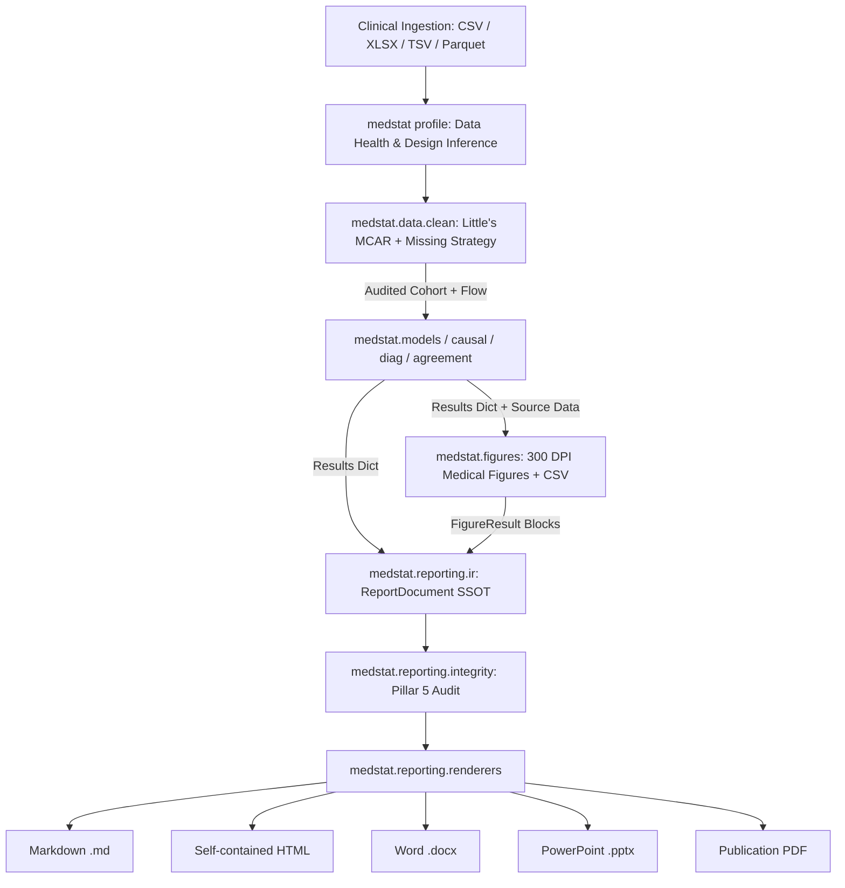

# ARCHITECTURE.md — System Architecture & Structural Diary

System architecture and structural specifications for `medstat-core` and the `medstat` CLI in `shinystat-skills`.

## 1. High-Level Architecture Overview

`medstat` is a headless, production-ready biostatistical computation engine and CLI application designed for offline-first clinical research, electronic health records (EHR) analytics, and automated biomedical manuscript preparation.

```
                          ┌───────────────────────────┐
                          │      shinystat Skill      │
                          │ (Autonomous Decision Agent│
                          │   + Grilling Gate)        │
                          └─────────────┬─────────────┘
                                        │ adapts & writes
                                        ▼
                          ┌───────────────────────────┐
                          │  Custom Python Scripts &  │
                          │     medstat CLI / SAP     │
                          └─────────────┬─────────────┘
                                        │ executes
                                        ▼
      ┌─────────────────────────────────┴─────────────────────────────────┐
      │                      Core Calculation Modules                     │
      ├───────────────────┬───────────────────┬───────────────────────────┤
      │  medstat.data     │  medstat.models   │  medstat.diagnostic       │
      │  - clean          │  - glm / firth    │  - 2x2 contingency        │
      │  - missing (MICE) │  - survival (cox) │  - ROC & DeLong CIs       │
      │  - retention flow │  - splines (RCS)  │  - DCA net benefit        │
      ├───────────────────┼───────────────────┼───────────────────────────┤
      │  medstat.causal   │  medstat.meta     │  medstat.reporting        │
      │  - psm matching   │  - DL random-eff  │  - NEJM / JAMA / APA 7    │
      │  - balance & SMD  │  - forest data    │  - STROBE/CONSORT/TRIPOD  │
      │  - love plots     │  - Egger(cont>=10)│  - methods narrative      │
      ├───────────────────┴───────────────────┴───────────────────────────┤
      │                     medstat.agreement                             │
      │  - Bland-Altman LoA with Bland–Altman (1999) large-sample CIs     │
      │  - Pure-SciPy Intraclass Correlation Coefficient (ICC) (No GPL)   │
      │  - Cohen's & Fleiss' Kappa (Categorical Inter-Rater Agreement)    │
      └───────────────────────────────────────────────────────────────────┘
```

---

## 2. Module Seams & Responsibilities

### `medstat.data`
- **`loader.py`**: Universal clinical tabular ingestion (.csv, .tsv, .xlsx, .parquet) with auto-encoding detection, whitespace stripping, and fuzzy column suggestion.
- **`clean.py`**: Missingness auditing, Little's MCAR multivariate test, Winsorization / IQR outlier handling, and strategy routing.
- **`missing.py`**: Implementation of `complete-case`, `mice` (via Bayesian ridge chained equations), `knn`, and `indicator` methods. Raises `MissingStrategyRequiredError` if missing data exists without an explicit strategy and documented justification.
- **`retention.py`**: `SampleFlowTracker` recording participant retention ($N_{\text{initial}} \to N_{\text{excluded}} \to N_{\text{analyzed}}$) with categorized reasons.

### `medstat.models`
- **`glm.py`**: OLS linear regression and standard binary logistic regression via `statsmodels`.
- **`firth.py`**: Firth penalized logistic regression and penalized Cox proportional hazards via `firthmodels` with profile likelihood confidence intervals.
- **`survival.py`**: Cox proportional hazards modeling via `lifelines` and Grambsch-Therneau Schoenfeld residual correlation tests; Competing Risks survival analysis via non-parametric Aalen-Johansen Cumulative Incidence Functions (`fit_competing_risks_cif`, Greenwood 95% CIs, probability conservation audit, $1 - \text{KM}$ overestimation evaluation) and dual-model regression (`fit_competing_risks_regression`: Cause-Specific Cox for etiology and Fine-Gray subdistribution hazards via IPCW counting process expansion with robust sandwich variance).
- **`splines.py`**: Restricted cubic splines (RCS) with flexible knot placement via pure-Python `rcs_lib.py` for both Cox proportional hazards and multivariable logistic regression.
- **`sensitivity.py`**: VanderWeele & Ding E-value computation for point estimates and lower/upper confidence bounds.
- **`ordinal.py`**: Proportional odds logistic regression via `OrderedModel`, Brant's Wald test (Brant 1990) for parallel lines assumption, positional boolean masking, and multinomial logistic fallback.
- **`multilevel.py`**: Clustered data analysis via population-averaged Generalized Estimating Equations (GEE) with robust sandwich standard errors, random-intercept mixed models via direct design matrices (`sm.MixedLM`), cluster design effect (DEFF / ICC_cluster) calculation with numeric outcome verification, and strict covariate missingness detection.
- **`__init__.py`**: Public exports including `extract_primary_effect` for polymorphic extraction of effect estimates across GLM, Firth, Cox, and GEE models.

### `medstat.diagnostic`
- **`accuracy.py`**: Complete 2x2 contingency metrics (Sensitivity, Specificity, PPV, NPV, LR+, LR-, DOR) with Wilson score confidence intervals, low-is-abnormal directionality handling, and `validate_gold_standard` reference standard integrity validation.
- **`roc.py`**: Non-parametric empirical ROC curve, Youden's J cutpoint, DeLong covariance matrix calculation for paired AUC comparisons, Continuous and Categorical Net Reclassification Improvement (`compute_reclassification_metrics`: NRI events, non-events, total, $K \times K$ contingency matrices), Integrated Discrimination Improvement (IDI), combined diagnostic model comparison (`compare_diagnostic_models`), and Cumulative/Dynamic IPCW Time-Dependent ROC (`compute_time_dependent_roc`: $\text{AUROC}(t)$ trajectory, optimal cutoffs, bootstrap CIs, competing risk control).
- **`dca.py`**: Vickers Decision Curve Analysis calculating net benefit across threshold probabilities relative to "Treat All" and "Treat None".
- **`calibration.py`**: Model calibration assessment: Brier score (with scaled Brier), calibration slope & intercept via logistic recalibration, Integrated Calibration Index (ICI / E50 / E90 / Emax) per Austin & Steyerberg (2019), Hosmer-Lemeshow goodness-of-fit test, and Plotly calibration plot generation.
- **`validation.py`**: TRIPOD+AI optimism-corrected bootstrap internal validation (`bootstrap_internal_validation`) calculating apparent, bootstrap, test, and optimism-corrected metrics (AUROC, Brier score, Nagelkerke $R^2$, calibration intercept and slope), uniform shrinkage factor $\hat{s}$ estimation, shrunk logistic regression coefficients, and clinical guardrails (EPP < 10, severe overfitting, non-convergence). Model recalibration (`recalibrate_prediction_model`) evaluating validation data across intercept-only (calibration-in-the-large) and logistic recalibration (intercept and slope updates) with pre- vs post-updating calibration indices.

### `medstat.causal`
- **`psm.py`**: Propensity score estimation via logistic regression, 1:1 nearest neighbor matching with logit standard deviation caliper, and matched cohort extraction.
- **`iptw.py`**: Inverse Probability of Treatment Weighting (`compute_iptw_weights`, `fit_iptw_outcome_model`) supporting ATE, ATT, ATC, and Overlap Weights (ATO; Li et al., 2018), stabilized weights, winsorized quantile truncation, Kish's effective sample size ($N_{\text{eff}}$), positivity audits ($PS < 0.05$ or $> 0.95$), and robust Huber-White outcome models (WLS, Logistic GLM, Cox PH).
- **`balance.py`**: Standardized Mean Difference (SMD) calculation for continuous and binary variables with Bessel-corrected weighted sample variance, multi-cohort balance tables (unadjusted, matched, weighted), and Austin 2009 Love plot data generation with multi-marker traces.
- **`mediation.py`**: Pure-Python parametric causal mediation analysis (Baron-Kenny / Imai) with quasi-Bayesian Monte Carlo confidence intervals for Average Causal Mediation Effect (ACME) and Average Direct Effect (ADE).

### `medstat.meta`
- **`models.py`**: Fixed-effects inverse variance and DerSimonian-Laird random-effects meta-analysis, Cochran's Q test, and Higgins $I^2$.
- **`forest.py`**: Forest plot structured data generation.
- **`bias.py`**: Egger's linear regression test for funnel plot asymmetry (applicable when $k \ge 10$ distinct studies with unstandardized continuous effect measures such as mean difference; SMD is not supported because its effect estimate and standard error are artifactually correlated, and it is not recommended for binary log odds ratios for the same reason).

### `medstat.agreement`
- **`bland_altman.py`**: Paired measurement difference analysis and limits of agreement with Bland–Altman (1999) large-sample approximate CIs. Supports both wide paired columns and long-format rater data.
- **`icc.py`**: Pure SciPy/NumPy two-way ANOVA decomposition computing Shrout & Fleiss (1979) forms (ICC1, ICC2, ICC3, ICC1k, ICC2k, ICC3k) with exact F-distribution confidence intervals.
- **`kappa.py`**: Cohen's Kappa (unweighted, linear, quadratic with non-null and null SEs) and Fleiss' generalized multi-rater Kappa for discrete categories.

### `medstat.power`
- **`sample_size.py`**: Sample size determinations for clinical trials and observational prediction models. Implements Riley et al. (BMJ 2020;368:m441) 4-criteria sample size for multivariable prediction model development (`calculate_riley_sample_size`: global shrinkage factor $\ge 0.90$, small margin in apparent vs adjusted $R^2$, precise intercept estimation, small MAPE) with automated numerical transformation of C-statistic or Nagelkerke $R^2$ to Cox-Snell $R^2_{CS}$ and max possible $R^2_{CS,\max}$. Diagnostic AUROC sample size (`calculate_diagnostic_auroc_sample_size`) per Obuchowski (1998, 2004) and Hanley & McNeil (1982) with case-to-control prevalence allocation.

### `medstat._phi`
- **`_phi.py`**: SSOT for HIPAA/PDPA Protected Health Information detection. Defines compiled regular expressions (`PHI_PATTERNS`) for Hospital Numbers (`HN: ...`), 13-digit Thai National Citizen IDs, telephone numbers, birth dates, and honorific-prefixed names (`Mr.`, `Mrs.`, `Ms.`, `Dr.`, `นาย`, `นาง`, `นางสาว`, `นพ.`, `พญ.`, `ดร.`), exposed via `assert_zero_phi_text`.

### `medstat.figures`
- **`base.py`**: Extended `FigureResult(png_path, alt_text, caption, source_df, csv_path, vector_path, svg_path, qa)` contract supporting automated multi-format bundle export (300/600 DPI PNG, TrueType vector PDF, SVG, CSV).
- **`journal.py`**: Journal House Styles engine defining target specifications for **NEJM**, **JAMA**, **LANCET**, **BMJ**, and **CLINICAL/Nature** (`JOURNAL_SPECS`). Provides canvas geometry mapping (`TARGET_WIDTHS`: single, 1.5, double column), `apply_journal_theme` (setting TrueType `pdf.fonttype=42`), L-frame axis spines with outward ticks (`style_axis`), and clinical report formatters (`format_estimate`, `format_p_value`).
- **`flow.py`**: Top-down programmatic layout cursor (`Flow`) for publication-grade study flowcharts with strict mathematical reconciliation (raises on count mismatches). Implements templates for CONSORT 2025 (reporting participants analyzed for primary outcome per Item 13c) and 2010 (`consort_rct`), PRISMA 2020 single- and dual-stream (`prisma_2020`), STARD 2015 diagnostic accuracy with $2 \times 2$ cells (`stard_flow`), STROBE observational cohort flow (`cohort_flow`, `cohort_flow_from_tracker` linked directly to `SampleFlowTracker`), and analytical methods pipelines (`methods_pipeline`). Exports 600 DPI PNG, vector PDF, SVG, and coordinate CSV.
- **`illustration.py`**: Vector-first scientific schematic engine (`Scene`) powered by semantic art palette (`SEM`: erythrocyte red, platelet amber, neutrophil red, macrophage purple, fibroblast green, stratified tissue colors, wound beds). Generates biological cells, tissue cross-sections, wound healing phases, pressure injury staging (NPUAP/EPUAP Stages 1–4), vascular stenosis % calculations, and signaling pathways. Automatically enforces conceptual schematic disclaimer, 600 DPI, vector PDF, SVG, and coordinate CSV.
- **`qa.py`**: Publication quality assurance gate module: text layout collision detection (`qa_layout`), color vision deficiency simulation (`cvd_check` for deuteranopia/protanopia/tritanopia), and Zero-PHI verification (`assert_zero_phi_text`).
- **`styles.py`**: Baseline publication styling (300 DPI, Okabe-Ito/Tol colorblind palettes, Thai typography fallback chain: `Sarabun`, `Thonburi`, `Sukhumvit Set`, `Arial`) and `save_figure_bundle`.
- **`forest.py`**: Forest plots for OR/HR/RR multivariable models and meta-analyses with 3-zone layout and journal styling.
- **`survival.py`**: Stratified Kaplan-Meier survival curves with aligned Numbers at Risk table and log-rank p-value, optional NEJM low-event zoomed inset (`nejm_inset_ylim`), and risk table CSV export; Cumulative Incidence Function (`plot_cif`) step curves under competing risks with Greenwood 95% CIs and Naive $1 - \text{KM}$ overestimation overlay.
- **`roc.py`**: ROC curves with 45-degree chance diagonal, Youden optimal cutpoint, DeLong 95% CIs, paired overlay, Risk Reclassification scatter plots (`plot_reclassification`, `plot_dual_reclassification`), and Time-Dependent ROC trajectory and multi-horizon curve plots (`plot_time_dependent_roc`, `plot_dual_time_dependent_roc`).
- **`calibration.py`**: Decile calibration plots with Wilson CIs, LOESS curves, Brier score, and ICI; Model Recalibration comparison plots (`plot_recalibration_comparison`, `plot_dual_recalibration_comparison`) with 45-degree ideal diagonal; Bootstrap Optimism grouped bar/dumbbell plots (`plot_bootstrap_optimism`, `plot_dual_bootstrap_optimism`).
- **`dca.py`**: Decision Curve Analysis with Net Benefit comparison against Treat All and Treat None with journal styling.
- **`agreement.py`**: Bland-Altman agreement plots with mean bias, 95% Limits of Agreement, and 1999 large-sample CIs with journal styling.
- **`balance.py`**: Austin 2009 Love plots for PSM and IPTW covariate balance with 0.10 SMD threshold and flexible column alias mapping.
- **`retention.py`**: Pure-Matplotlib STROBE / CONSORT participant retention flowcharts.
- **`diagnostics.py`**: Missingness heatmaps, Schoenfeld proportional hazards residuals, and MICE density overlays.
- **`html/`**: Dedicated mirror submodule for Dual / Toggle View (`DualFigureResult`, `plot_dual_roc_curve`, `plot_dual_reclassification`, `plot_dual_time_dependent_roc`, `plot_dual_kaplan_meier`, `plot_dual_cif`, `plot_dual_calibration`, `plot_dual_recalibration_comparison`, `plot_dual_bootstrap_optimism`, `plot_dual_dca`, `plot_dual_bland_altman`, `plot_dual_forest`, `plot_dual_love`) and pure-Python Plotly spec styling synchronization with journal styles (`sync_plotly_to_journal`). Produces companion Plotly interactive visualizations (primary view) alongside "Publication 300 DPI Figure (Static)" Matplotlib images with instant toggle switching and direct journal download links.

### `medstat.reporting`
- **`tables.py`**: Journal-compliant polymorphic HTML table rendering (NEJM, JAMA, APA 7) with strict border rules, no vertical dividers, and support for Table 1, Regression, Diagnostic accuracy, Reclassification tables (`format_reclassification_table`), Time-Dependent ROC tables (`format_time_dependent_roc_table`), Bland-Altman, ICC, Covariate balance (unadjusted, matched, weighted), Competing Risks (`render_competing_risks_table`), Bootstrap internal validation (`format_internal_validation_table`), Recalibration (`format_recalibration_table`), and Riley sample size (`format_riley_sample_size_table`).
- **`narrative.py`**: Automated biomedical Methods and Results narrative generation.
- **`checklists.py`**: Audited item checklists for STROBE, CONSORT, TRIPOD, STARD (diagnostic studies), and PRISMA (systematic reviews).
- **`ir.py`**: Report Intermediate Representation (IR) acting as Single Source of Truth (`ReportDocument`, `Block`, `HeadingBlock`, `ParagraphBlock`, `TableBlock`, `FigureBlock`, `CalloutBlock`).
- **`renderers/`**: Multi-format document renderers:
  - `markdown.py`: GitHub Flavored Markdown + linked assets directory (`render_markdown`).
  - `html.py`: Self-contained single-file HTML with embedded base64 figures, ICMJE 3-rule table styling, Output Format Alignment Gate defaults, and Dual / Toggle View (`render_html`) placing Plotly interactive charts as the primary view with a toggle to "Publication 300 DPI Figure (Static)" for journal submission, offline fallback resilience, and print parity.
  - `docx.py`: Native Microsoft Word `.docx` with OpenXML `<w:tblBorders>` 3-rule borders and 6.5 in figures (`render_docx`).
  - `pptx.py`: Native PowerPoint 16:9 widescreen presentation with 1 figure per slide layout and structured takeaway cards (`render_pptx`).
  - `pdf.py`: High-fidelity PDF rendering via Playwright headless Chromium with LibreOffice fallback (`render_pdf`).
- **`integrity.py`**: Pillar 5 Reporting Integrity audit (`verify_report_integrity`): numerical traceability to `results_dict` ($\pm 0.02$), Zero-PHI regex scan (HN, Thai citizen ID, phone, names), and observational causal inference / E-value caveat enforcement.

---

## 3. Data Flow & Contract Interfaces



All subcommands and renderers emit structured contracts allowing deterministic composition into pipelines, agent tools, and manuscript packages.

---

## 4. Multi-Agent Skill Mirror Parity & SSOT Seam

```
┌────────────────────────────────────────────────────────┐
│               src/medstat/ (Package SSOT)               │
└───────────────────────────┬────────────────────────────┘
                            │ rsync / parity check
                            ▼
┌────────────────────────────────────────────────────────┐
│         skills/shinystat/scripts/medstat/ (Canonical)   │
└───────────────────────────┬────────────────────────────┘
                            │ automated mirror sync
      ┌─────────────────────┼─────────────────────┐
      ▼                     ▼                     ▼
┌───────────┐         ┌───────────┐         ┌───────────┐
│  .agent/  │         │  .agents/ │         │  .claude/ │ (.cursor/)
└───────────┘         └───────────┘         └───────────┘
```

- **SSOT Integrity**: `src/medstat/` is the single source of truth for the biostatistical calculation engine.
- **Automated Parity Gate**: `test_src_medstat_and_skills_bundled_medstat_byte_identical()` in `tests/unit/test_shinystat_skill.py` ensures 100% byte-for-byte fidelity across all 78 engine modules between `src/medstat/` and `skills/shinystat/scripts/medstat/`.
- **Zero-Setup Mirrors**: Multi-agent workspace directories (`.agent/`, `.agents/`, `.claude/`, `.cursor/`) are maintained in lockstep via `./scripts/install-skills.sh --sync` to support instant out-of-the-box discovery without manual installation.
